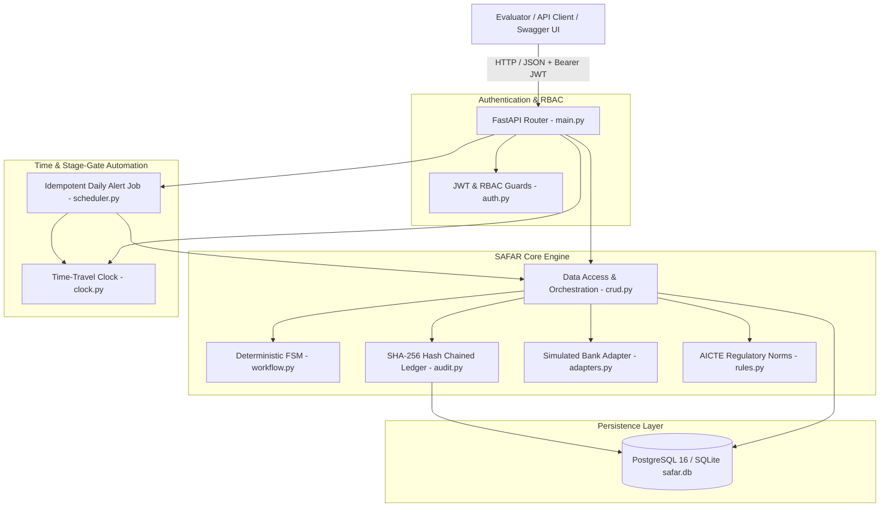
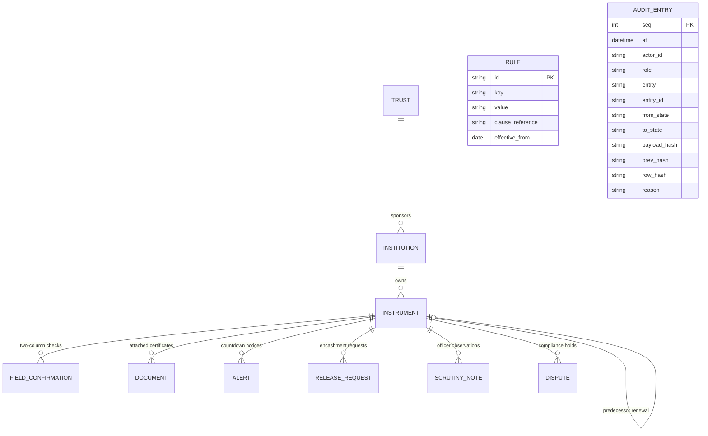
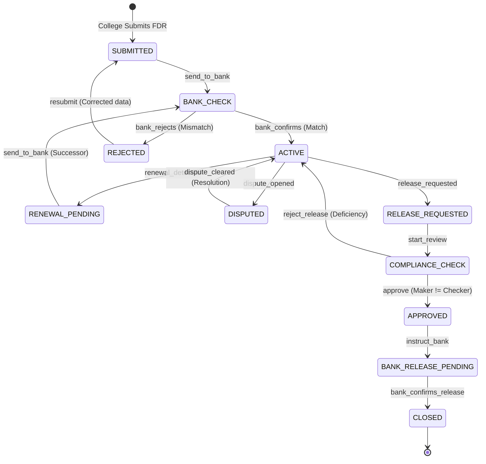

# SAFAR — System Architecture & Technical Specification
**Smart India Hackathon (SIH Problem Statement 26265)**  
*AICTE Regulation Bureau — Smart Automation (Software)*  
**Team:** Code Blooded

---

> [!IMPORTANT]
> ### ⚠️ Regulatory & Simulation Notice
> **All bank confirmations, SFMS feeds, and CBS responses in SAFAR are SIMULATED.**  
> In compliance with SIH guidelines and Indian banking regulations, no real banking gateways (RBI, SFMS, or nodal CBS) are accessed. All banking interactions are isolated within deterministic mock adapters in `backend/adapters.py` and labeled `[SIMULATED]`.

---

## 1. Architectural Philosophy & Design Principles

SAFAR (Smart AICTE FDR Automation & Registry) is engineered as a **sovereign GovTech / Fintech compliance registry**. It replaces error-prone spreadsheets and paper certificate tracking with a tamper-evident, double-verified, state-machine-driven compliance engine.

### Core Principles
1. **Flat Backend Monolith:**  
   Avoids over-engineered nested micro-frameworks. All core services sit in a flat, readable `backend/` directory (`main.py`, `models.py`, `schemas.py`, `crud.py`, `workflow.py`, `audit.py`, `scheduler.py`, `clock.py`, `adapters.py`, `auth.py`).
2. **Single Source of Truth State Machine:**  
   No SQL `UPDATE` statement alters an instrument's status directly. All transitions pass through `workflow.transition()`, which evaluates a strict transition matrix and guards.
3. **Two-Column Trust Reconciliation:**  
   Every certificate record independently captures **Institution-Submitted Data** side-by-side with **Bank-Confirmed Data** before an instrument can become `ACTIVE`.
4. **Append-Only Cryptographic Audit Ledger:**  
   Every state change, note, dispute, or approval is permanently recorded in a SHA-256 hash-chained ledger. Any tampering of past entries is mathematically detectable.
5. **Idempotent Stage-Gate Scheduling:**  
   Batch jobs calculate maturity stages (`180D`, `90D`, `60D`, `30D`, `7D`, `DUE_TODAY`, `OVERDUE`) idempotently. Running the job 10 times in an hour produces the exact same state without duplicate alerts.
6. **Time-Travel Demo Clock:**  
   A settable clock allows evaluators to simulate the passage of months in seconds, demonstrating countdown alerts and renewals on demand.

---

## 2. High-Level System Architecture (C4 Component Model)

---

## 3. The 11 Domain Models & Database Schema

The relational schema is defined in `backend/models.py`:

### Table Definitions:
1. **`trusts`**: Sponsoring educational trusts and societies.
2. **`institutions`**: Regulated technical colleges (Engineering, Management, Pharmacy, etc.).
3. **`instruments`**: Fixed Deposit Receipts (FDRs) and Bank Guarantees (BGs).
4. **`field_confirmations`**: Two-Column Trust records comparing college submissions against bank records.
5. **`documents`**: PDF scan metadata with SHA-256 file hashes.
6. **`alerts`**: Proactive stage-gate notifications generated by the scheduler.
7. **`release_requests`**: Security deposit release requests with pre-release checklist items.
8. **`scrutiny_notes`**: Formal audit observations recorded by AICTE officers.
9. **`disputes`**: Legal, faculty salary, or compliance holds that strictly lock release.
10. **`rules`**: Regulatory configuration parameters (deposit amounts per category, alert thresholds).
11. **`audit_entries`**: Cryptographically chained immutable ledger rows.

---

## 4. Finite State Machine (FSM) Lifecycle

The instrument lifecycle is governed by the state machine in `backend/workflow.py`:

### Guard Enforcement Matrix

| From State | Event | Target State | Guards Enforced |
|---|---|---|---|
| `SUBMITTED` | `send_to_bank` | `BANK_CHECK` | `guard_required_fields_present` |
| `BANK_CHECK` | `bank_confirms` | `ACTIVE` | `guard_bank_checker_differs` |
| `BANK_CHECK` | `bank_rejects` | `REJECTED` | `guard_reason_provided` |
| `ACTIVE` | `release_requested`| `RELEASE_REQUESTED`| `guard_no_open_dispute` |
| `COMPLIANCE_CHECK` | `approve` | `APPROVED` | `guard_no_open_dispute` `guard_maker_differs_from_checker` `guard_checklist_cleared` |
| `ACTIVE` | `dispute_opened` | `DISPUTED` | `guard_reason_provided` |
| `DISPUTED` | `dispute_cleared`| `ACTIVE` | `guard_reason_provided` |

---

## 5. Cryptographic Hash-Chain Ledger

Every state change appends a record in `backend/audit.py`.

### Mathematical Formulation
$$\text{RowHash}_n = \text{SHA-256}\Big(\text{Seq}_n \parallel \text{Timestamp}_n \parallel \text{PrevHash}_n \parallel \text{CanonicalJSON}(\text{Payload}_n)\Big)$$

- **Genesis Block:** Linked to constant `0000000000000000000000000000000000000000000000000000000000000000`.
- **Tamper Evidence:** Modifying any historical row's reason, actor, or payload invalidates all subsequent row hashes.
- **Verification API:** `GET /audit/verify` traverses from sequence 1 to head, reporting the exact broken sequence number if tampered.

---

## 6. Deployment & Environment Topology

- **Local Development:**
  - Database: PostgreSQL 16 container on port `5433` (or automatic fallback to local `sqlite:///./safar.db`).
  - App Server: Uvicorn ASGI server running FastAPI on port `8000`.
- **Production Blueprint (`render.yaml`):**
  - Web Service: Python 3.11 with `uvicorn main:app --host 0.0.0.0 --port 10000`.
  - Managed Database: PostgreSQL on Render Cloud.
  - Multi-Container Orchestration: `docker-compose.yml` with health-checked PostgreSQL service.
